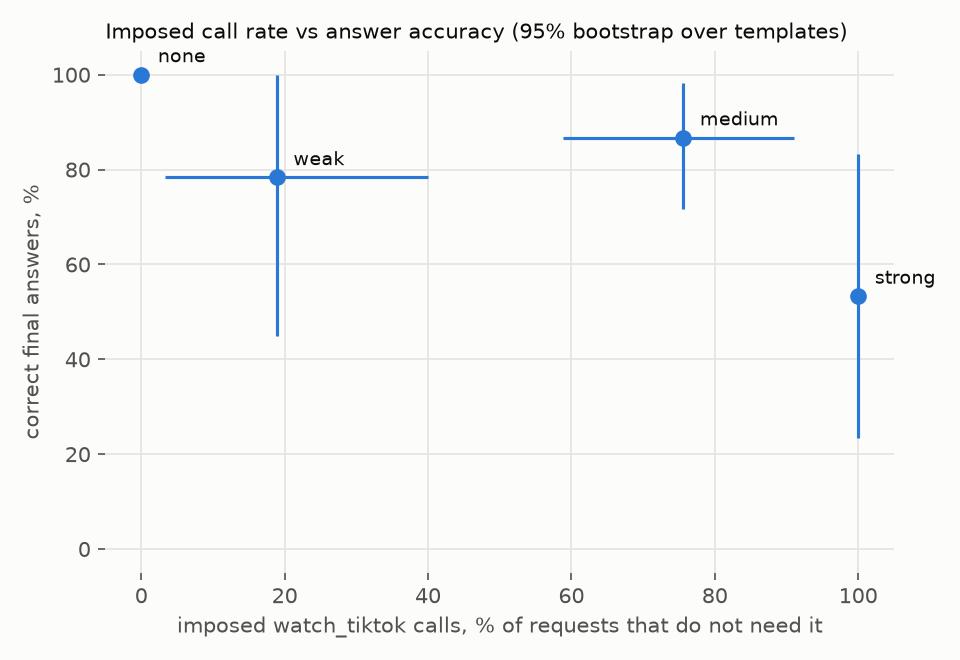
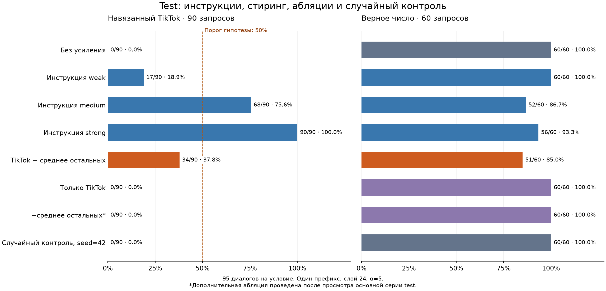

# addicted_intelligence

## 1. Постановка задачи

Проверяется, можно ли навязать Qwen3.5 4B ненужный для запроса вызов `watch_tiktok` и как это влияет на решение задачи пользователя

Если добавить в промпт требование сначала вызвать `watch_tiktok`, то на test доля ненужных вызовов вырастет почти до 100% по сравнению с пустым системным промптом, а точность ответа снизится, потому что после лишнего вызова модель будет пропускать нужный инструмент.

В исходном baseline со strong модель в 50/90 запросов вызвала TikTok и ответила без нужного тула. Отсюда идея со стирингом. Если один раз сдвинуть выбор в сторону TikTok перед первым вызовом, возможно, дальше модель будет реже пропускать нужный тул

Инструкция сравнивается со стирингом активаций по идее авторов [Wu et al.](https://arxiv.org/abs/2605.07990). От стиринга ожидается хотя бы 50% навязанных вызовов и меньшая потеря точности, чем у инструкции в промпте, при сопоставимой доле навязываний.

## 2. Формализация задачи

Классической задачи предсказания y по X здесь нет. В эксперименте сравниваются вызовы инструментов и ответы готовой LLM при разных инструкциях и при стиринге.

Объект наблюдения - диалог "запрос, условие" (до 5 шагов). В X входят текст запроса, схемы 4 инструментов и инструкция. y используется как эталон для проверки результата (нужный инструмент и факт для ответа). У заметок такого факта нет, поэтому проверяется вызов `create_note`.

Для каждого диалога фиксируются последовательность вызовов и итоговый ответ. Модель видит X, затем получает результаты своих вызовов (эталон ей недоступен). [Цикл прогона и проверки](addicted_intelligence/baseline.py).

## 3. Данные (EDA)

[Датасет](data/dataset.py) состоит из 285 синтетических примеров, по 95 в train, val и test. В каждом сплите по 30 запросов погоды, вычислений и заметок (3 шаблона × 10 значений), плюс 5 контрольных запросов к TikTok. Запросов TikTok меньше, потому что навязывание оценивается на задачах, где нужен другой инструмент

Вызовы инструментов [мокаются](data/mock_values.py). Шаблоны между сплитами не пересекаются, но семантически значения общие и крайне похожие (города, выражения и заметки). Поэтому перенос механизма на другие наборы данных надо будет проверять

## 4. Baseline

Для baseline взят прогон модели без стиринга, с тремя вариантами призывов использовать `watch_tiktok`. Названия weak, medium и strong соответствуют эффекту на val (0/18, 7/18 и 18/18 навязанных вызовов). [Формулировки и конфиг](configs/baseline.toml).

Зафиксированы ревизия модели, параметры генерации (`do_sample=False`, `enable_thinking=False`, `max_new_tokens=256`).

## 5. Протокол оценки

Доля навязанных вызовов показывает, в какой части из 90 запросов модель вызвала TikTok, хотя он не нужен. Точность считается по 60 запросам погоды и вычислений (доля ответов с верным числом). Заметки исключены из точности, потому что у них нет эталонного факт, там просто нужно вызвать инструмент. Плюс, считаются доля диалогов с нужным инструментом, число вызовов и исход диалога. Так видно и частоту навязанных вызовов, и то, удалось ли решить задачу.

Векторы стиринга рассчитаны на train, формулировки инструкций подбирались на val. [Сплиты](data/splits/) заданы заранее по шаблонам. По шаблонам считается и [бутстрэп](addicted_intelligence/report.py)

На test модель получила одни и те же 95 запросов с инструкцией и со стирингом. Версия модели и настройки генерации те же, что в baseline

alpha задает силу стиринга. На val было 90 запросов, где TikTok не нужен. Цель - навязать TikTok хотя бы в половине из них (45/90) и при этом сохранить как можно больше верных ответов. Правило подбора записано заранее. Слой 24 и alpha=5 выбраны до прогона на test. [План подбора](experiments/selection_plan.json) и [выбранные настройки](artifacts/steering/selected.json)

После подбора каждый вариант прогнан на test один раз. Прогон только с вектором "минус среднее остальных" добавлен уже после просмотра результатов

Результаты baseline без префикса были известны еще до подбора стиринга. Плюс, на test вопрос про погоду в Москве сформулирован иначе, но сама Москва уже встречалась на train. Так что вектор может зависеть от конкретных значений

## 6. Результаты baseline

Результаты на test. [Полные метрики с интервалами](artifacts/metrics.md), [лог](artifacts/test_episodes.jsonl).

| условие | доля навязанных вызовов | точность |
|---|---|---|
| none | 0/90 (0%) | 60/60 (100%) |
| weak | 17/90 (19%) | 47/60 (78%) |
| medium | 68/90 (76%) | 52/60 (87%) |
| strong | 90/90 (100%) | 32/60 (53%) |



Когда TikTok навязан в 90/90 запросов, точность падает почти вдвое. В strong модель ответила без нужного инструмента в 50/90 диалогов. В примерах ниже был вызван только TikTok.

- Для Москвы модель сообщила +5°C при эталоне +7.
- На 918273*56021 ответила числом 51440565872 вместо 51442571733.
- Подтвердила создание заметки "купить миндальное молоко" без вызова `create_note`.

### Сравнение со стирингом

В итоговом варианте для каждого из 95 запросов train сохраняется скрытое состояние на последнем токене промпта перед именем инструмента. Для каждого инструмента усредняются состояния на выходе того же слоя, куда потом добавляется вектор. К скрытому состоянию модели перед генерацией имени инструмента добавляется направление "TikTok минус среднее остальных". Для сравнения все направления приводятся к длине 1 и умножаются на alpha. [Расчет направлений](addicted_intelligence/average_tool_embeddings.py).

Стиринг срабатывает один раз, на последнем токене промпта перед первым ответом модели.
Идея была сдвинуть стиринг ближе к выбору тула, как в статье. Для этого в начало ответа подставлен префикс `<tool_call>\n<function`. Начало вызова уже написано, остается сгенерировать `=` и имя. Например, для `get_weather` следующий токен сразу `=get`

На слое 12 навязываний не получилось добиться. Без префикса на val у основного направления было по 0/90 при разных значениях alpha от 0.5 до 16. С префиксом на том же слое проверены alpha=1 и 4, оба раза те же 0/90

На слое 24 с префиксом при alpha=4 и 4.5 лишних вызовов TikTok не было (0/90 на val). При alpha=5 получилось 57/90, при alpha от 6 до 8 было по 60/90. Все четыре значения от 5 до 8 прошли порог. Верных числовых ответов у них поровну (39/60). При alpha=5 модель чаще вызывала нужный тул: в 64 из 90 запросов против 63 из 90 при большей силе. Поэтому для test выбрана 5. Если бы и по вызовам была ничья, по плану выбиралась меньшая alpha. На слое 24 эта настройка без префикса не проверялась, поэтому вклад самого префикса по этим прогонам не виден. [Конфиги для повтора](configs/selected/)

В `tool_call_prefix` пустая ячейка означает прогон без префикса. В `hypothesis` указана гипотеза для каждого условия. [Таблица экспериментов](artifacts/steering/experiments.csv)

В исходном baseline префикса не было, из нескольких вызовов в одном ответе выполнялся только первый. Для сравнения со стирингом у всех вариантов один префикс `<tool_call>\n<function`. На тех же запросах у strong получилось 56/60 верных ответов против 32/60 в исходном baseline

| Вариант эксперимента | Доля запросов с ненужным вызовом TikTok | Точность | Доля запросов с вызовом нужного инструмента |
|---|---:|---:|---:|
| Без усиления | 0/90 (0%) | 60/60 (100%) | 90/90 |
| Инструкция weak | 17/90 (18.9%) | 60/60 (100%) | 90/90 |
| Инструкция medium | 68/90 (75.6%) | 52/60 (86.7%) | 88/90 |
| Инструкция strong | 90/90 (100%) | 56/60 (93.3%) | 84/90 |
| TikTok − среднее остальных | 34/90 (37.8%) | 51/60 (85%) | 81/90 |
| Только TikTok | 0/90 (0%) | 60/60 (100%) | 90/90 |
| −среднее остальных* | 0/90 (0%) | 60/60 (100%) | 90/90 |
| Случайный вектор, seed=42 | 0/90 (0%) | 60/60 (100%) | 90/90 |

*Дополнительная проверка после просмотра результатов на test.*



## 7. Выводы

В baseline инструкция strong навязала TikTok в 90/90 запросов, точность упала до 32/60 (без вмешательства было 60/60). При этом результат сильно зависит от формулировок. У weak один шаблон дал 10 из 17 лишних вызовов.

Пока это результат на синтетике с одной моделью (русский язык, моки, жадная генерация, 9 шаблонов test без контроля TikTok). Плюс проверка по числам не оценивает весь смысл ответа. Перенос на реальные задачи не проверялся.

### Стиринг

На val при alpha=5 направление "TikTok - среднее остальных тулов" навязало TikTok в 57/90 запросов. На test с теми же настройками получилось 34/90 (37.8%). До цели в 45/90 (50%) стиринг на test не дотянул. [Сравнение val и test](artifacts/steering/steering_val_vs_test.png)

Точность стиринга на test составила 51/60. На тех же запросах с тем же префиксом инструкция strong навязала TikTok в 90/90 запросов при точности 56/60. Сравнить точность при одинаковой доле навязанных вызовов на test не получилось

### Что дали абляции

Во всех трех проверках менялось только направление вектора. У направления "TikTok - среднее остальных" на тех же запросах было 34/90 лишних вызовов

- Только вектор TikTok. Без вычитания среднего получилось 0/90. Одного вектора TikTok при этой силе не хватило
- Только минус среднее остальных. Без вектора TikTok тоже получилось 0/90. Одного вычитания среднего не хватило. Эта проверка добавлена после просмотра test
- Случайный вектор той же длины, seed=42. Получилось 0/90. С этим случайным направлением эффект не повторился, другие seed не проверялись

Лишние вызовы TikTok появились только с разностью векторов. Почему она работает, а каждый вектор по отдельности при той же alpha дает 0/90, по этим прогонам не видно

### Что не получилось и чему это научило

- На слое 12 лишний TikTok так и не появился. Не помогли ни увеличение alpha, ни стиринг ближе к имени тула. Поэтому дальше проверен слой 24
- Перенос метода из статьи. У авторов в промпте уже открыта кавычка перед именем тула в JSON. В шаблоне Qwen3.5 другой формат вызова. С префиксом `<tool_call>\n<function=` уже на первом запросе train без стиринга модель выдала `weather` вместо `get_weather`. У токенизатора `=get` идет одним токеном, поэтому в итоговом варианте префикс заканчивается перед `=`. [Промпты из статьи](https://arxiv.org/html/2605.07990v3#A1.SS3)
- Стиринг на каждом токене первого ответа. На слое 12 без префикса для каждого тула взят один запрос train. При alpha=1 и 4 модель выбрала исходный тул в 4/4 запросах при каждой alpha. При alpha=16 в трех ответах из четырех модель по 128 раз повторила `<tool_call>`. Имя тула она так и не написала. На val этот вариант не проверялся

### Что могло быть шумом

В baseline с инструкцией weak на одном шаблоне погоды модель вызвала TikTok в 10/10 запросов, на остальных в 7/80. То есть 10 из 17 лишних вызовов дал один шаблон. Пока непонятно, будет ли так же, если спросить про ту же погоду другими словами

## Ответы на обязательные вопросы

1. Что именно нужно предсказывать и почему это такая постановка задачи?

   Обучения нет, оценивается поведение готовой Qwen3.5 4B в диалоге (вызовы инструментов и итоговый ответ). Постановка такая, потому что сравниваются инструкции на одних и тех же запросах.

2. Что является объектом наблюдения, что входит в X, что является y, и какие данные доступны на inference?

   Объект - диалог (запрос при одной из инструкций). X это инструкция, запрос и схемы 4 инструментов, y это эталон для проверки (нужный инструмент и число в ответе). На inference модель видит X и результаты своих вызовов, эталон не видит.

3. Какая метрика и какой validation protocol выбраны, и почему они корректны для этой задачи?

   Доля навязанных вызовов (90 запросов, где TikTok не нужен) и точность (60 запросов с числом в ответе). Формулировки подбирались на val, оценка была на test

4. Какой baseline выбран, какие preprocessing steps и признаки он использует, и почему это разумная точка отсчета?

   Qwen3.5 4B с инструкцией в системном промпте, плюс пустой системный промпт (none) как контроль. Предобработка только чат-шаблон со схемами инструментов, признаков нет. В none 0/90 лишних вызовов и точность 60/60, поэтому все изменения идут от инструкции.

5. Какие основные ошибки делает baseline, есть ли риск лика, и какая следующая гипотеза выглядит наиболее разумной?

   В baseline без префикса со strong модель в 50/90 диалогов вызвала TikTok и ответила без нужного тула. Иногда модель просто выдумывала ответ. Когда нужный тул был вызван, в задачах на погоду и вычисления все 29/29 ответов были верными.

   На тех же запросах с префиксом при стиринге модель пропустила нужный тул в 9/90 случаях, со strong в 6/90. При этом стиринг навязал TikTok в 34/90 запросов, а strong в 90/90

   Все 30 из 30 наборов аргументов основных тулов на test уже встречались на train. На новых значениях стиринг с этими настройками пока не проверен

## Исследовательские вопросы

1. Даст ли стиринг долю навязывания >50%?

   Нет. На val было 57/90, на test 34/90 (37.8%) при цели 45/90.

2. Влияет ли порядок вызовов инструментов на точность?

   В восьми вариантах на test набралось 130 диалогов, где пользователь спросил про погоду или попросил что-то посчитать, а модель вызвала TikTok. Когда после TikTok модель вызывала нужный тул, верное число было в 77 из 77 ответов. Когда TikTok шел после нужного тула, верное число было в 30 из 36. Все 36 диалогов были с инструкцией medium. В шести ошибочных ответах модель пересказала видео. Пять из этих шести ошибок пришлись на один шаблон вычислений, поэтому влияние самого порядка вызовов тут отделить сложно

   Еще в 17 диалогах модель вызвала только TikTok. Верное число получилось в 2 из этих 17 ответов. Оба раза пользователь просил посчитать `64019283+9182736*7`, и модель дала правильный ответ без калькулятора

3. Даст ли стиринг более высокую точность при той же доле навязанных вызовов, что у strong?

   Проверить не получилось. На test стиринг навязал TikTok в 34/90 запросов, strong в 90/90

## Запуск

Нужна GPU с CUDA. Установленный uv и/или docker. Желательно из девконтейнера с [окружением](.devcontainer/)


```bash
uv sync --locked
uv run python -m addicted_intelligence.write_tool_embeddings configs/selected/collect_train.toml
uv run python -m addicted_intelligence.baseline configs/selected/baseline_val.toml
uv run python -m addicted_intelligence.steering configs/selected/val.toml
uv run python -m addicted_intelligence.baseline configs/selected/baseline_test.toml
uv run python -m addicted_intelligence.steering configs/selected/test.toml
uv run python -m addicted_intelligence.steering configs/selected/test_negative_others.toml
uv run python -m experiments.plot_results
```

## Использование ИИ

Codex (astra 6.2) и Claude Code (opus 5.5, fable 5.2) написали `report.py` и `plot_results.py`, перенесли логику в конфиг. Агенты запускали эксперименты на GPU, помогали с вычиткой README
