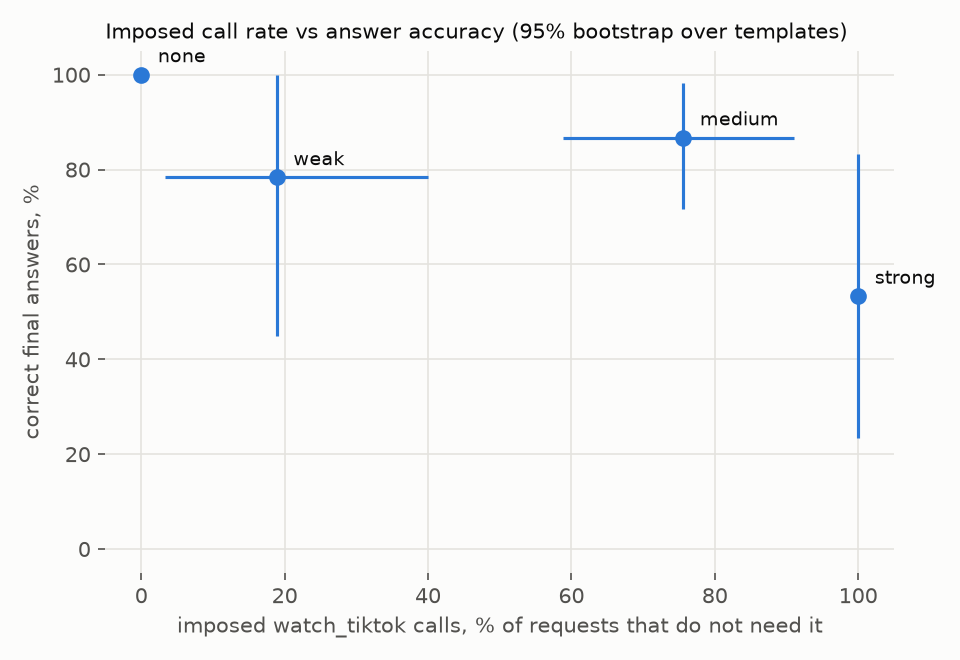

# addicted_intelligence

## 1. Постановка задачи

Проверяется, можно ли навязать Qwen3.5 4B ненужный для запроса вызов `watch_tiktok` и как это влияет на решение задачи пользователя

Если добавить в промпт требование сначала вызвать `watch_tiktok`, то на test доля ненужных вызовов вырастет почти до 100% по сравнению с пустым системным промптом, а точность ответа снизится, потому что после лишнего вызова модель будет пропускать нужный инструмент.

планируется сравнение со стирингом активаций по идее авторов [Wu et al.](https://arxiv.org/abs/2605.07990). От стиринга ожидается хотя бы 50% навязанных вызовов и меньшая потеря точности, чем у инструкции в промпте. 

Пока проверен baseline с инструкциями в промпте

## 2. Формализация задачи

Классической задачи предсказания y по X здесь нет. В эксперименте сравниваются вызовы инструментов и ответы готовой LLM при разных инструкциях.

Объект наблюдения - диалог "запрос, условие" (до 5 шагов). В X входят текст запроса, схемы 4 инструментов и инструкция. y используется как эталон для проверки результата (нужный инструмент и факт для ответа). У заметок такого факта нет, поэтому проверяется вызов `create_note`.

Для каждого диалога фиксируются последовательность вызовов и итоговый ответ. Модель видит X, затем получает результаты своих вызовов (эталон ей недоступен). [Цикл прогона и проверки](addicted_intelligence/baseline.py).

## 3. Данные (EDA)

[Датасет](data/dataset.py) состоит из 285 синтетических примеров, по 95 в train, val и test. В каждом сплите по 30 запросов погоды, вычислений и заметок (3 шаблона × 10 значений), плюс 5 контрольных запросов к TikTok. Запросов TikTok меньше, потому что навязывание оценивается на задачах, где нужен другой инструмент

Вызовы инструментов [мокаются](data/mock_values.py). Шаблоны между сплитами не пересекаются, но семантически значения общие и крайне похожие (города, выражения и заметки). Поэтому перенос механизма на другие наборы данных надо будет проверять

## 4. Baseline

Для baseline взят прогон модели без стиринга, с тремя вариантами призывов использовать `watch_tiktok`. Названия weak, medium и strong соответствуют эффекту на val (0/18, 7/18 и 18/18 навязанных вызовов). [Формулировки и конфиг](configs/baseline.toml).

Зафиксированы ревизия модели, параметры генерации (`do_sample=False`, `enable_thinking=False`, `max_new_tokens=256`).

## 5. Протокол оценки

Доля навязанных вызовов показывает, в какой части из 90 запросов модель вызвала TikTok, хотя он не нужен. Точность считается по 60 запросам погоды и вычислений (доля ответов с верным числом). Заметки исключены из точности, потому что у них нет эталонного факт, там просто нужно вызвать инструмент. Плюс, считаются доля диалогов с нужным инструментом, число вызовов и исход диалога. Так видно и частоту навязанных вызовов, и то, удалось ли решить задачу.

train оставлен для стиринга, инструкции к промпту подбирались на val, итоговая оценка проводилась на test. Сплит и бутстрэп идут по шаблонам

## 6. Результаты baseline

Результаты на test. [Полные метрики с интервалами](artifacts/metrics.md), [лог](artifacts/test_episodes.jsonl).

| условие | доля навязанных вызовов | точность |
|---|---|---|
| none | 0/90 (0%) | 60/60 (100%) |
| weak | 17/90 (19%) | 47/60 (78%) |
| medium | 68/90 (76%) | 52/60 (87%) |
| strong | 90/90 (100%) | 32/60 (53%) |



Когда TikTok навязан в 90/90 запросов, точность падает почти вдвое. В strong модель ответила без нужного инструмента в 50/90 диалогов. В примерах ниже был вызван только TikTok.

- Для Москвы модель сообщила +5°C при эталоне +7.
- На 918273*56021 ответила числом 51440565872 вместо 51442571733.
- Подтвердила создание заметки "купить миндальное молоко" без вызова `create_note`.

## 7. Выводы

В baseline инструкция strong навязала TikTok в 90/90 запросов, точность упала до 32/60 (без вмешательства было 60/60). При этом результат сильно зависит от формулировок. У weak один шаблон дал 10 из 17 лишних вызовов.

Пока это результат на синтетике с одной моделью (русский язык, моки, жадная генерация, 9 шаблонов test без контроля TikTok). Плюс проверка по числам не оценивает весь смысл ответа. Перенос на реальные задачи не проверялся.

## Ответы на обязательные вопросы

1. Что именно нужно предсказывать и почему это такая постановка задачи?

   Обучения нет, оценивается поведение готовой Qwen3.5 4B в диалоге (вызовы инструментов и итоговый ответ). Постановка такая, потому что сравниваются инструкции на одних и тех же запросах.

2. Что является объектом наблюдения, что входит в X, что является y, и какие данные доступны на inference?

   Объект - диалог (запрос при одной из инструкций). X это инструкция, запрос и схемы 4 инструментов, y это эталон для проверки (нужный инструмент и число в ответе). На inference модель видит X и результаты своих вызовов, эталон не видит.

3. Какая метрика и какой validation protocol выбраны, и почему они корректны для этой задачи?

   Доля навязанных вызовов (90 запросов, где TikTok не нужен) и точность (60 запросов с числом в ответе). Формулировки подбирались на val, оценка была на test

4. Какой baseline выбран, какие preprocessing steps и признаки он использует, и почему это разумная точка отсчета?

   Qwen3.5 4B с инструкцией в системном промпте, плюс пустой системный промпт (none) как контроль. Предобработка только чат-шаблон со схемами инструментов, признаков нет. В none 0/90 лишних вызовов и точность 60/60, поэтому все изменения идут от инструкции.

5. Какие основные ошибки делает baseline, есть ли риск лика, и какая следующая гипотеза выглядит наиболее разумной?

   После TikTok модель пропускает нужный инструмент и выдумывает ответ (в strong 50/90 диалогов). Когда нужный инструмент в strong вызван, ответ верен (29/29). В baseline лика нет (обучения нет), но значения общие между сплитами, поэтому для стиринга нужен test с новыми значениями. Дальше проверить, реже ли модель пропускает нужный инструмент при стиринге, чем при strong.

## Исследовательские вопросы

1. Даст ли стиринг долю навязывания >50%? 
2. Влияет ли порядок вызовов инструментов на точность?
3. Даст ли стиринг более высокую точность при той же доле навязанных вызовов, что у strong?

## Запуск

Нужна GPU с CUDA. Установленный uv и/или docker. Желательно из девконтейнера с [окружением](.devcontainer/)


```bash
uv sync --locked
uv run python -m data.dataset
uv run python -m addicted_intelligence.baseline
uv run python -m addicted_intelligence.report --episodes artifacts/test_episodes.jsonl --output-dir artifacts
```

## Использование ИИ

Claude Code (opus 5.5, fable 5.2) использовался для написания `report.py` целиком, переноса логики в конфиг, а также для вычитки и форматирования README
